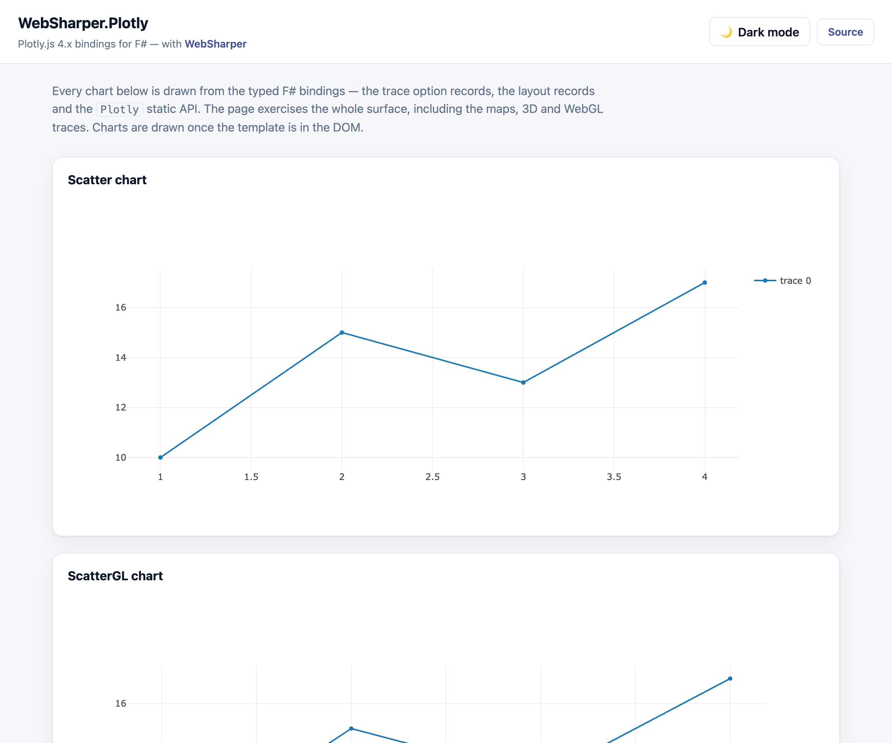

# WebSharper.Plotly

[](https://www.nuget.org/packages/WebSharper.Plotly)

WebSharper bindings for [Plotly.js](https://plotly.com/javascript/) 4.x (4.3.0+) —
typed F#/C# wrappers for the interactive charting library.

The binding consumes the npm packages [`plotly.js-dist-min`](https://www.npmjs.com/package/plotly.js-dist-min)
and [`plotly.js-locales`](https://www.npmjs.com/package/plotly.js-locales) as ES
modules (`import Plotly from "plotly.js-dist-min"`) and is bundled by your
toolchain (esbuild in the sample); there is no CDN `<script>` tag.

This repository contains:

| Project | Purpose |
| --- | --- |
| `WebSharper.Plotly` | The binding: the `Plotly` static API (`newPlot`, `react`, `restyle`, `relayout`, `update`, `toImage`, …) and the typed trace options for every 2D/3D/WebGL/map/domain trace, plus the layout and configuration records. |
| `WebSharper.Plotly.Tests` | The sample and test case: a static SPA (esbuild → `dist/`) that draws 44 charts — one per trace type — covering the whole typed surface, including the map, 3D and WebGL traces. |

## Live demos

**Try it live:** [Open the sample in your browser](https://dotnet-websharper.github.io/plotly/)



The sample doubles as the binding's [test case](#running-the-test-case): it draws
44 charts — one per trace type — from the typed option records, the layout
records and the `Plotly` static API. It covers the whole surface, including the
`scattermap`/`choroplethmap`/`densitymap` tiles, the 3D and WebGL traces, and the
`locale` option. It is light-themed by default and has a light/dark theme
switcher (persisted in `localStorage`).

- **Sample (this repository):** <https://dotnet-websharper.github.io/plotly/>
- **WebSharper:** <https://websharper.com>

## Install

```bash
dotnet add package WebSharper.Plotly
```

Or with Paket:

```fsharp
nuget WebSharper.Plotly
```

The package targets `netstandard2.0` and works with any WebSharper 10 or 11
project. It supports Plotly.js `>= 4.3.0 < 5.0.0` (the 4.x line); Plotly.js
itself is pulled from npm (`plotly.js-dist-min`), so the JS bundle step must
resolve it (WebSharper's SPA/esbuild build does this automatically).

## Usage

All types live in the `WebSharper.Plotly` namespace.

### Draw a chart

```fsharp
open WebSharper
open WebSharper.JavaScript
open WebSharper.Plotly

[<JavaScript>]
let DrawScatter () =
    let trace = ScatterOptions()
    trace.X <- [|1; 2; 3; 4|]
    trace.Y <- [|10; 15; 13; 17|]
    trace.Mode <- ScatterModes.Lines_markers

    Plotly.Plotly.NewPlot("scatterchartDiv", [|trace|])
```

The first argument is the element id (or an `HTMLElement`); the layout and the
configuration options are optional.

### Update an existing chart

```fsharp
let layout = Layout()
layout.Title <- LayoutTitle(Text = "Updated title")

Plotly.Plotly.React("scatterchartDiv", [|trace|], layout, null)
Plotly.Plotly.Relayout("scatterchartDiv", layout) |> ignore
```

### Maps

The `map`-family traces use `layout.map` (the `mapbox` subplot and its
`accesstoken` were removed in plotly.js 4.0):

```fsharp
let scatterMap = ScatterMapOptions()
scatterMap.Lat <- [|37.5; 40.0; 42.0|]
scatterMap.Lon <- [|-95.0; -100.0; -105.0|]

let mapLayout = Layout()
mapLayout.Map <- LayoutMap(Style = "open-street-map")

Plotly.Plotly.NewPlot("scattermapchartDiv", [|scatterMap|], mapLayout)
```

### Notes on the API

- **Plotly.js 4.x is the npm-based line.** The binding imports
  `plotly.js-dist-min` as an ES module; the `locales` are imported from
  `plotly.js-locales/<locale>` (e.g. `Locale.FR`).
- **`mapbox` traces were renamed to `map`.** `ScatterMapBox` → `ScatterMap`,
  `ChoroplethMapBox` → `ChoroplethMap`, `DensityMapBox` → `DensityMap`, and
  `layout.mapbox` → `layout.map`. The `mapboxAccessToken`/`accesstoken` option
  was removed in 4.0. The `stamen-*` styles are deprecated; use the
  `carto-*`/`open-street-map` styles.
- **`heatmapgl` was removed.** `HeatMapGL` is gone from the 4.x line; use the
  `heatmap` trace (WebGL) or `ScatterGL` instead.
- **`modebar` buttons were updated.** The `sendDataToCloud` and `resetViewMapbox`
  buttons are now `sendChartToCloud` and `resetViewMap`; the `modeBarButtonsToRemove`
  and `modeBarButtonsToAdd` options are now lists.
- **`hidesources` was removed.** The old `layout.hidesources` option is gone.
- **`layout` is optional.** The `NewPlot` overloads accept `(div, traces)`,
  `(div, traces, layout)` or `(div, traces, layout, options)`.

## Running the test case

The sample is a static SPA. Building it runs `npm install` and esbuild and emits
`dist/` at the repository root:

```bash
dotnet build WebSharper.Plotly.Tests/WebSharper.Plotly.Tests.fsproj -c Release
dotnet serve -d dist -p 5311
```

`dotnet serve` comes from the [`dotnet-serve`](https://github.com/dotnet-serve/dotnet-serve)
tool; install it once with `dotnet tool install -g dotnet-serve` (or use
`dotnet tool run dotnet-serve` with a local tool manifest).

Open <http://localhost:5311/>. Plotly.js is fully bundled, so no network access
is needed for the charts (the map tiles use the public map tile servers). The
page renders all 44 charts; use the theme toggle to switch between light and
dark.

## Building from source

### Prerequisites

- [.NET SDK 11](https://dotnet.microsoft.com/download) (the WebSharper 11
  compiler needs the .NET 11 runtime).
- [Node.js](https://nodejs.org/) (for the sample's esbuild step).
- [Paket](https://fsprojects.github.io/Paket/) as a local dotnet tool (configured
  in `.config/dotnet-tools.json`).

### Restore and build

```bash
dotnet tool restore
dotnet paket restore
dotnet build WebSharper.Plotly.sln -c Release
```

The binding targets `netstandard2.0`; the sample is a static bundle.

### Pack the NuGet package

After a Release build (so the assembly exists in `bin/Release/netstandard2.0`):

```bash
dotnet paket pack ./out
```

## Deployment

Pushing to `main` triggers `.github/workflows/ghpages.yml`, which builds the
sample in Release and publishes `dist/` to the `gh-pages` branch via GitHub
Pages.

## Repository layout

```
WebSharper.Plotly/               # the binding (WIG definitions)
  Main.fs
  Layout/Layout.fs
  Options/Options.fs
  Common.fs
  Traces/                        # one file per trace type
WebSharper.Plotly.Tests/         # static SPA demo / test case
  Client.fs
  index.html
  site.css
  esbuild.config.mjs
  wsconfig.json
docs/
  sample.png                     # screenshot of the running sample
nuget/                           # Paket pack template
.github/workflows/ghpages.yml     # build + deploy the sample
```

## License

Apache 2.0 — see [LICENSE.md](LICENSE.md).
